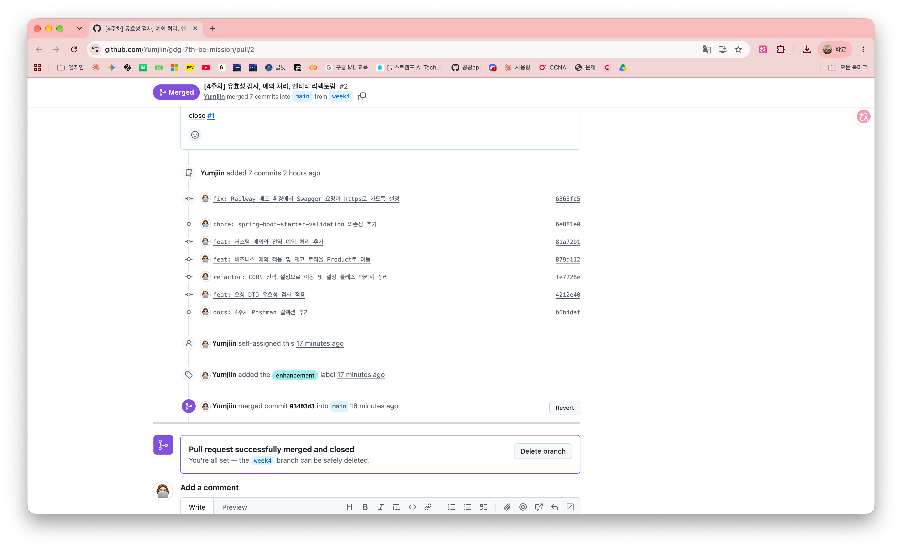
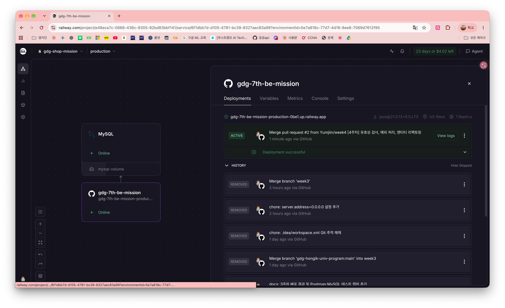
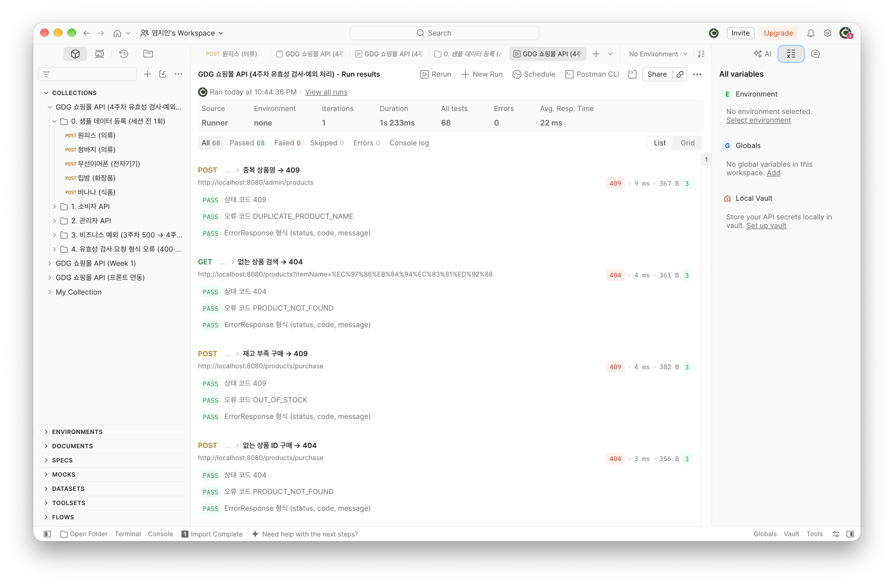
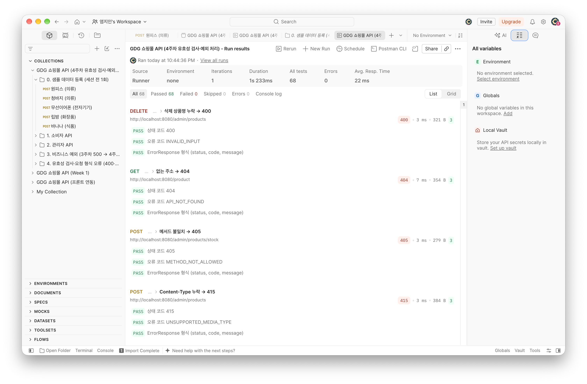
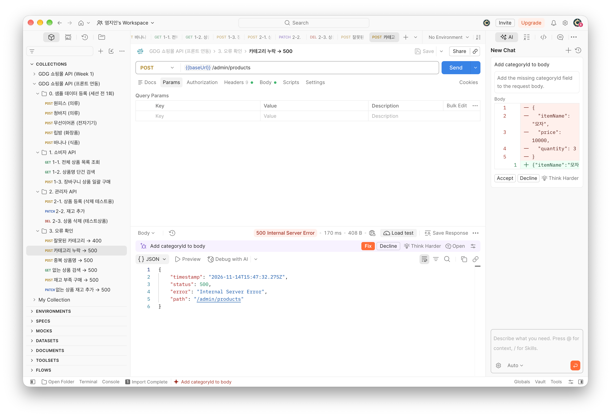
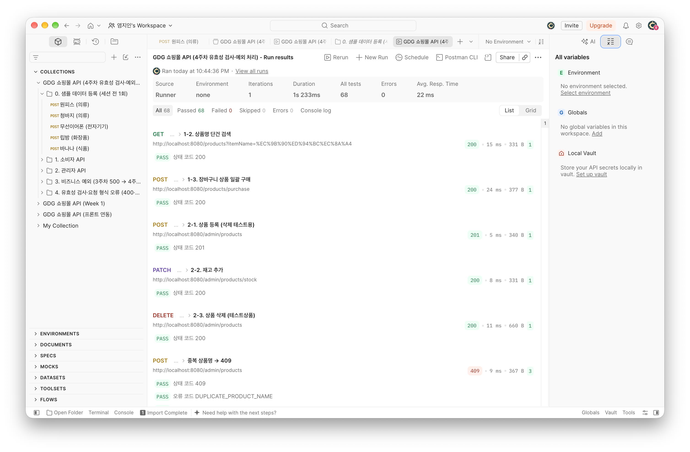

# Week 4 — 배포 확인

## 1. week4 → main Pull Request 머지

`week4` 브랜치를 PR로 내 레포 `main`에 머지했습니다. PR 본문의 `close #1`로 4주차 이슈가 함께 닫혔습니다.

## 2. Railway 자동 배포 (CD)

`main`에 머지되자 Railway가 머지 커밋으로 새 배포를 자동으로 시작했습니다.

## 3. 배포 서버 테스트 (Postman)

배포된 서버에 Postman 4주차 컬렉션을 실행해 성공 응답과 오류 응답(400·404·405·409·415)을 확인했습니다.

## 4. 오류 응답 비교 (3주차 → 4주차)

| 3주차 | 4주차 |
| --- | --- |
|  |  |